# Moida Mansion AI recreate in physical form

The goal of this project is a real handheld version of Moida Mansion: a custom segment LCD, a small microcontroller running the original game logic, four buttons and a piezo beeper. Most of the work is done together with AI agents, and this README is the log of how it went.

**Current status — November 22, 2026**

- The original LCD artwork (631 segments) is extracted and the LCD is routed on a 16 COM x 48 SEG matrix, with drawings exported for the LCD factory.
- The game is ported to portable C and matches the original browser game tick by tick in all tested sessions.
- The C game runs on a CH32X035 microcontroller and passed a 1,000-tick hardware test.
- The first custom LCD has arrived, and the prototype works electrically with an HT16C24A driver. Display quality is still unresolved: some segments are faint or disappear, and there is ghosting.
- The next experiment is an HT16H25 driver at 50 Hz instead of 80 Hz, to see whether slower scanning improves the suspected glass RC problem. This has not been tested yet.
- Still in progress: resolving the LCD drive issue, a smaller second LCD layout, the final PCB, buttons and case.

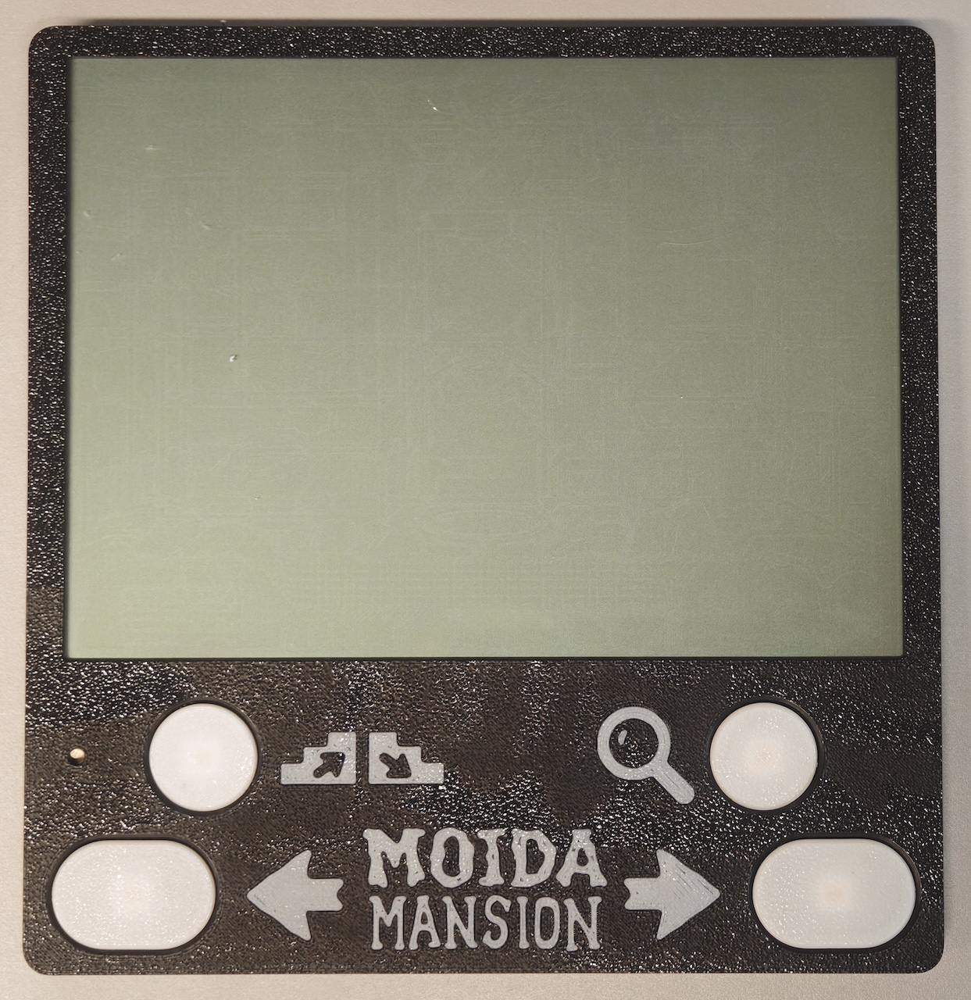

The first assembled prototype. See [Testing the first LCD](#testing-the-first-lcd) for the display results so far.

**Credits**

Moida Mansion, its artwork and its game code are by [Lucas Pope (dukope)](https://dukope.itch.io/moida-mansion). This is a personal, non-commercial fan project. Original game files (the browser build's `moida.js`, panel SVG and case images) are kept in this repository only as a reference to extract artwork and to test the port against. They remain the property of their author and are not covered by any licence of this repository. No licence has been chosen yet for my own code and drawings.

## Introduction

[Moida Mansion](https://dukope.itch.io/moida-mansion) is a 2024 video game by independent developer Lucas Pope. It is a browser game that imitates the visual design and gameplay of a handheld electronic game.

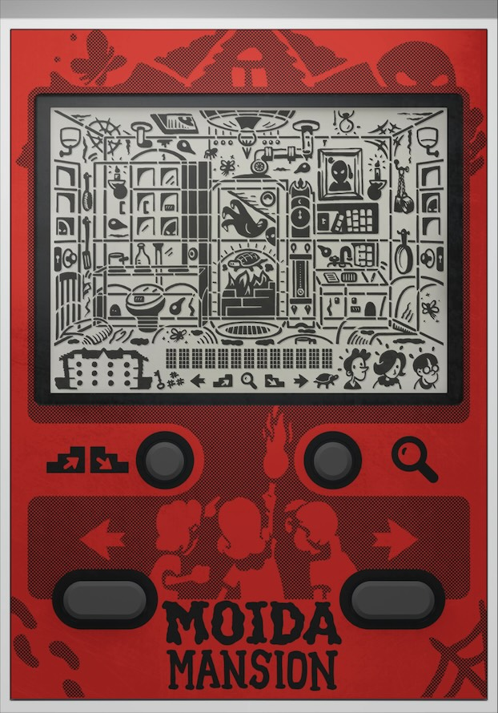

When I first saw this game, I wondered if it was possible to port it to a physical console with a customized LCD. However, extracting resources and doing LCD layout can be quite complicated. So I did not really do anything, until I had an OK experience with OpenAI GPT-6 Astra on PCB design. And here is the log of my progress.

## Extract resources

Extracting the LCD resources with AI is very straightforward. Just ask Astra to figure out the segments and connections, I got this in 7 minutes:

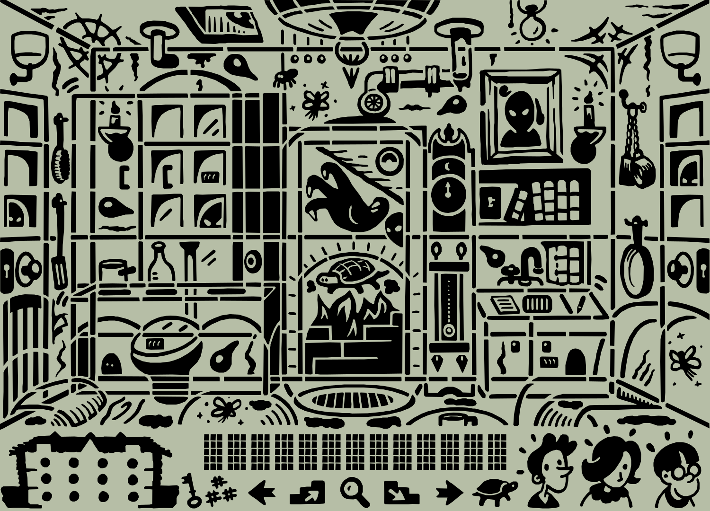

## Evaluate difficulty

There are 631 segments, that is way more segments than those Game & Watch or Tiger Electronics LCD consoles in 80s. I've checked the 4-bit Microcontroller the Game & Watch used, Sharp SM512. That Microcontroller supports 4 common lines and up to 50 segments. Overall the theoretical maximum segments are 50*4=200. So this LCD was not possible at that age.

The biggest LCD driver I could find is Holtek [HT16C24A](https://www.holtek.com/page/vg/HT16C24A) or [HT1626](https://www.holtek.com/page/vg/HT1626). They have up to 16 commons and 60 segments. That is 16*60=960 segments. So it is possible to drive a Moida Mansion LCD.

On the LCD side, I found a vendor that can customize LCD for samples. The specs are: 

Min track width and spacing: 0.12mm

Min segments spacing: 0.1mm

And the bigger the more expensive. 

Let's take the challenge.

## How LCD works in design perspective

Here I skip the physics about LCD, just talk about design.

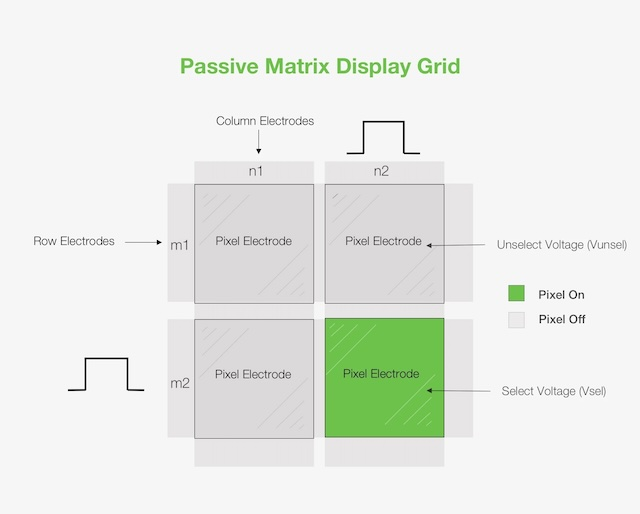

Rows and columns are laid on top and bottom of LCD screen. The overlapped area can be turned on. It seems like a 2 layer PCB without vias. The rows and column should form a matrix to maximize segments but they do not need to be on grid, they can be distorted to fit the segments.

## Routing the LCD

Will the Astra do the job for me?

The failure is expected. So let's go one step back and just make a tool to manually route the traces with DRC.

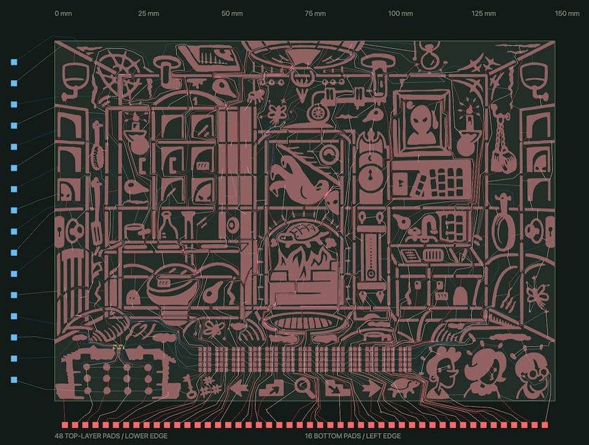

And after about 30 hours of routing, it is proven to be possible with a 16x48 matrix! The 631 game segments became 780 routed islands, using 664 of the 768 possible COM/SEG pairs.

Some tricks in routing. Since the topology of LCD matrix is a grid, we need to assign the segment in a grid way to avoid trace crossing. The grid in matrix area might be simple and easy to understand (yellow), but the grid can also be distorted to fit the segments (green). Also, the traces are colored with lighter and darker color alternatively, making reading easier.

Also to make the routing possible, I need to change some of the segment. For example, the house map ceiling is blocking me from routing traces up, so I have to make an opening in the ceiling. Also I made the traces cross there to save COM lines. It will cause some black dots in some cases, but that location should be fine.

And for some segments, I sliced them to be more sub segment to allow multiple wires to travel through them.

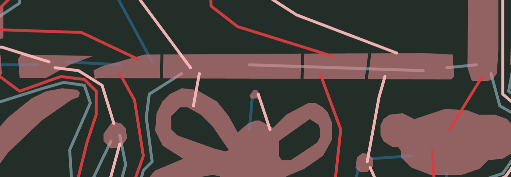

## Refine routing for manufacture

The first routing proved the matrix works, but the traces were not ready for a factory. So I rebuilt the tool as a second version (`2_refine_routing`) that starts from the finished routing and only cares about manufacturability.

The most important rule: the net of every segment is **frozen** from the first routing. In the first tool, a trace touching a segment could rename its net, and during refinement close or touching wires gave wrong assignments. Now new slices inherit the net of the segment they were cut from, and merging pieces with different nets is rejected.

The design rules I used, based on the vendor limits above:

| Rule | Value |
|---|---:|
| Minimum trace width | 0.12 mm |
| Same-layer trace to trace | 0.12 mm |
| Segment to trace | 0.12 mm |
| COM/SEG traces on opposite layers, outside segments | 0.1 mm |
| Display area | 150 x 108 mm |

The last rule is the special one for an LCD. A COM trace on one glass and a SEG trace on the other glass act like a tiny segment wherever they overlap. Inside a segment that is exactly what I want, but outside a segment it would show up as a stray dark mark. So COM and SEG traces must keep 0.1 mm apart when seen from the front, everywhere except inside the segments.

Each tool does what it is good at. The web tool's own routing is limited: it draws traces as manual polylines and does not walk around obstacles. But it owns everything LCD-specific: the frozen nets, slices, moving segments, editing their corners and measuring gaps. EasyEDA Pro is very good at routing, especially walk-around routing that slides thin traces between the electrodes. However, its DRC only knows normal PCB copper rules, and it cannot check the COM/SEG clearance rule above. So the routing happens in EasyEDA, and the final DRC happens in the web tool, which checks trace width, clearances, unwanted COM/SEG overlap and that every island connects to its contacts on both layers.

To make this practical, a small local backend moves the design back and forth between the two tools. EasyEDA Pro 4.x saves projects as plain-text JSON (the `.eprj3` project and the `.epcb2` PCB), so the backend reads and writes the project files directly instead of going through import and export dialogs. That makes the exchange fast. A Python bridge (`2_refine_routing/eda/server.py`) drives the EasyEDA app, and a converter (`convert.cjs`) translates between the web tool's geometry and the PCB file. The webpage has three buttons:

- **Send to EDA** writes the current design into one permanent EasyEDA project. Each island becomes a locked component with matching top and bottom electrodes, and the 0.12 mm design rules are written into the project too.
- **Open EDA** opens that project so I can route.
- **Import from EDA** reads the traces back (position, width, net and layer). Slices, segment shapes and frozen nets stay owned by the web tool.

More details are in the [EDA exchange notes](2_refine_routing/eda/README.md).

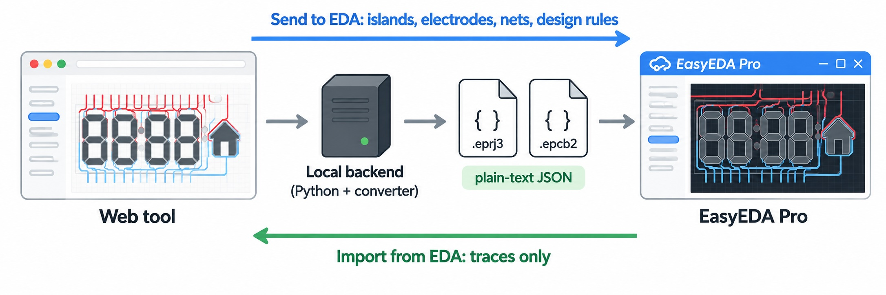

The connections go out through a zebra connector below the display: 16 COM contacts, two empty positions, then 48 SEG contacts. Each contact is 1 mm wide and 3 mm long, at 2 mm pitch, centered under the screen.

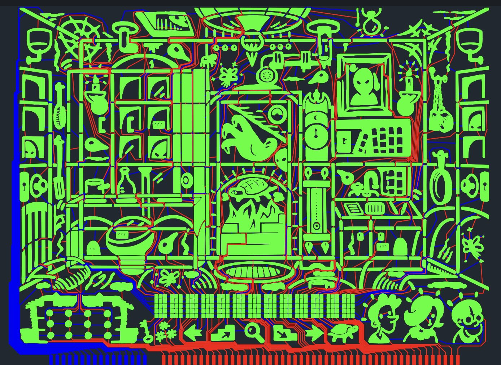

When the routing passes the web tool's DRC, the web tool exports a DXF file for the LCD manufacturer. It has TOP, BOTTOM and SEGMENT layers, exported singly or together, built from the edited geometry with solid fills and holes, and it opens directly in AutoCAD. The manufacturer did the final touch in AutoCAD and produced the manufacturing drawing, `workingLog/VN-F6339A.dwg`.

## Porting the game to C

An LCD is useless without the game. The browser build's `moida.js` turned out to be JavaScript generated by the Nim compiler, not a ROM or WebAssembly. There is no original source. So the agents reverse engineered the JavaScript directly into portable C11 (`4_game_runtime/native`).

The original JavaScript is kept unchanged and runs headless in Node as a test oracle. Every subsystem was ported and compared against it: the random generator, mansion and puzzle generation, room rendering, movement, search, keys, friends, monsters, ghosts, the spider, Dot, endings and automatic restart. The final full-session test replays the same timed button presses into both versions and compares all 20 display words, the beeper frequency and duration, inventory, statistics and the random state on every tick.

This proves the tested sessions match exactly, not every possible seed and input. The C core has no heap allocation and no OS dependency, and a small hardware abstraction layer ([HAL.md](4_game_runtime/HAL.md)) connects it to buttons, display, sound and a 100 ms tick.

To play it on a computer, there is a browser simulator (`live.html`). Python only relays button presses to the compiled C program, and the browser draws the LCD and plays the beeps. The simulator uses my routed and sliced segment artwork, so I can see exactly how the edited LCD will look in the game.

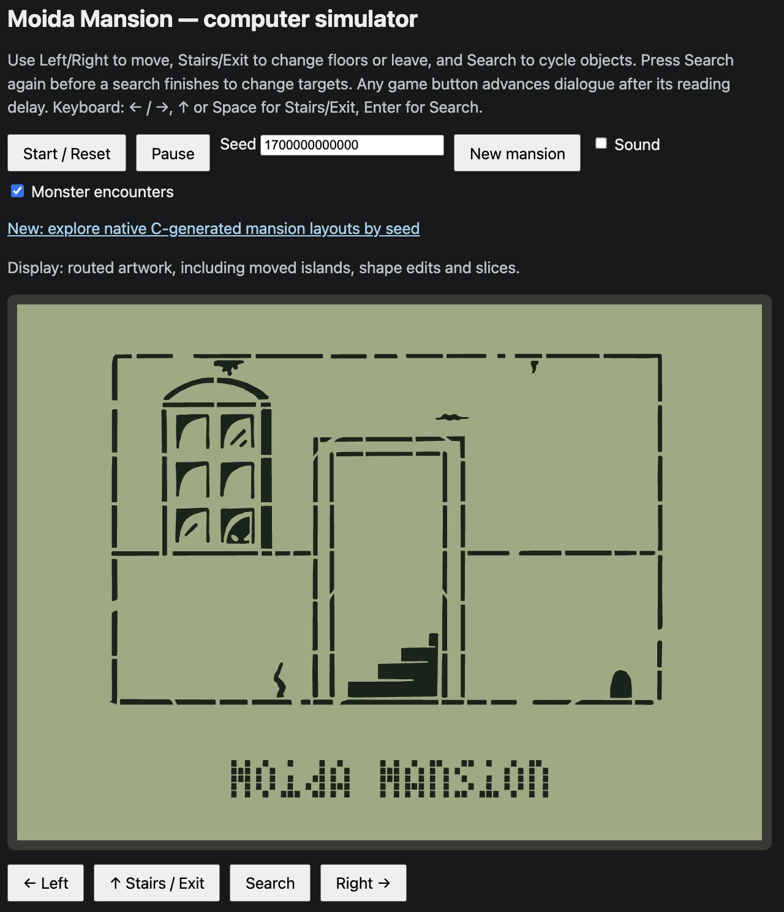

## Running on a microcontroller

The target microcontroller is the WCH **CH32X035** (RISC-V, 48 MHz, 62 KB flash, 20 KB RAM, USB). The first build did not fit: 75,692 bytes of flash against 63,488 available, and even with link-time optimization only a few hundred bytes of RAM were left. After a series of lossless optimizations (smaller coordinate and entity types, 10-bit packed sprite IDs, narrower tables, linking only the needed Arduino code) it fits with room to spare:

| Target | Flash | Static RAM |
|---|---:|---:|
| CH32X035 | 57,508 / 63,488 B | 14,188 / 20,480 B (plus 4 KB reserved stack) |

On real hardware, the X035 passed a 1,000-tick self-test with both the game display hash and the mapped LCD hash matching the computer. Initialization takes 74 ms, and the slowest tick takes 6.2 ms out of the 100 ms frame budget. An earlier test on a CH32V307 at 144 MHz also matched. There is also an MCU simulator page (`mcu.html`) that plays the game running on the board over USB.

Sound uses a piezo driven by TIM1 with complementary outputs (PB9/PB6), so both legs are driven in opposite phase for a louder beep. For the four buttons, PA0 to PA3 are the planned pins: they avoid USB, I2C and the piezo, they map directly to the game's button bits, and each one can wake the chip from deep sleep.

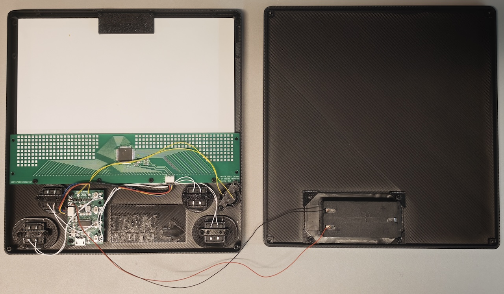

Inside the prototype: the LCD driver board sits above the microcontroller and button wiring, with the battery holder mounted in the back cover.

Mechanical STEP models are available in [`3_case_design/step_files/`](3_case_design/step_files/): the case back, round and long button covers, button backing, buzzer backing, LCD, and screen mounting parts. These document the current mechanical design work; the final case is still in progress.

## From game bits to LCD electrodes

The game only knows 631 segment bits, but the LCD has sliced islands on COM/SEG pairs. A generated lookup table (`4_game_runtime/lcd`) maps every one of the 768 COM/SEG cells to its game bit. All islands of a segment light together, even when they are on different pairs. The table is 1.5 KB of flash, and converting one frame takes about 0.8 ms on the X035. It is generated from the same saved routing file as the simulator artwork, so the two always agree.

## Testing the first LCD

The first **150 x 108 mm custom LCD is back from the factory**. The prototype works electrically and I can drive the glass with the HT16C24A, but the display does not look right yet.

When I turn on a whole COM row, segments near the connection look better, while farther ones become faint or disappear. Driving a SEG column gives a different result: the segments show, although the large one near the bottom is dim. There is also ghosting, so simply increasing contrast does not solve the problem.

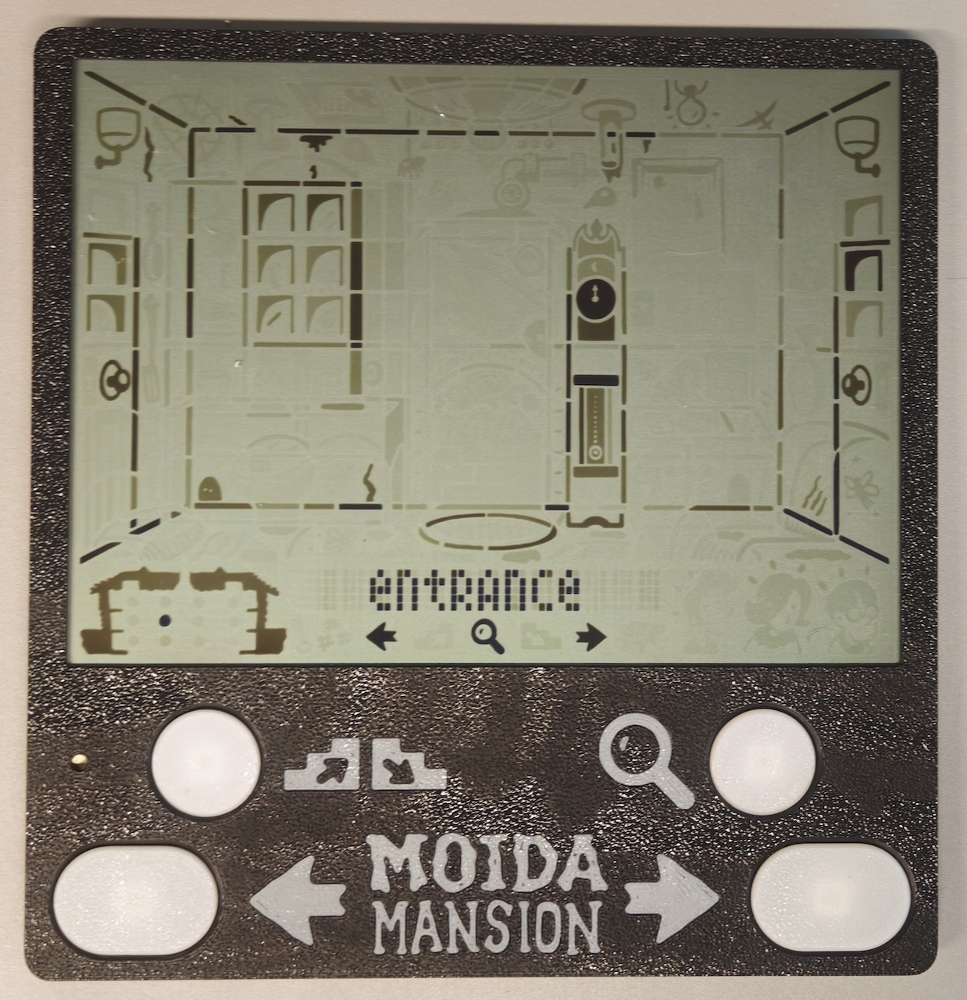

The entrance scene on the real LCD. The uneven contrast and ghosting are visible in this photo.

<!-- Photos to add: dedicated row and column test patterns showing the faint segments and ghosting. -->

The main suspect is **resistance and capacitance inside the glass**. The long, narrow transparent ITO traces have resistance, and the segment electrodes form capacitors. Together they can slow the drive waveforms enough that distant segments do not receive the intended voltage. Meeting the factory's minimum trace width and clearance rules was not enough to guarantee good display performance.

The manufacturer described the ITO as “30 ohms,” which the analysis assumes means **30 Ω/square**. At the artwork's 0.12 mm trace width, that would mean about **250 Ω per millimetre** of narrow trace. An RC model of the final manufacturing DXF supports this as a plausible contributor, but the glass capacitance is still an assumption and the model does not predict brightness. The calculations and limitations are in the [final DXF RC review](2_refine_routing/analysis/Final-DXF-RC-review.md).

The diagnosis also found a bias-setting mismatch in the test firmware and a possible supply limitation from the 1 kΩ VLCD feed. I removed that resistor and connected VLCD directly to 3.3 V, which gave acceptable brightness, but uniform contrast and ghosting remain the issues to resolve.

My next step is to try the **Holtek HT16H25**. Its [datasheet](https://www.holtek.com/webapi/116711/HT16H25v140.pdf) includes **50 Hz operation at 1/16 duty**, compared with the HT16C24A's minimum of 80 Hz. Moving from 80 Hz to 50 Hz gives each scan interval **60% more time**, which may let the glass waveforms settle more fully. This is a recovery experiment, not a confirmed fix: it cannot remove the ITO resistance, and slower scanning may make flicker more visible. It also needs a revised driver board and firmware because the two chips are not pin-compatible.

I plan to compare the HT16H25 at 80 Hz and 50 Hz using the same voltage, bias and test patterns, checking both intended segments and ghosting. The existing glass may still be usable; that is what this experiment will establish.

## Routing v3: a smaller LCD

Alongside testing the first glass, I am planning a second layout from scratch: **75 x 54 mm** (half the width and height, a quarter of the area) on a **16 COM x 60 SEG** matrix. The smaller layout targets a driver package exposing all 60 SEG outputs; the 80-pin HT16H25 being considered for the first glass exposes 48.

<!-- TODO: explain why I restarted with a smaller screen -->

The new tool (`5_routing_v3`) starts from the original artwork with no inherited routing. Instead of drawing traces first, I plan the electrical matrix as a deformable mesh: drag a COM/SEG intersection onto an island to assign that pair to it. When a drag would make mesh lines cross, the tool bends the lines or moves free neighbouring points, and rejects the drag if it cannot find a valid shape. Slicing, real traces, clearance-aware routing and selective autorouting are the next phases, described in the [v3 research notes](5_routing_v3/ROUTING_V3_RESEARCH.md).

<!-- Screenshot to add: workingLog/15_v3_mesh.png (v3 mesh assignment tool) -->

## Next steps

- Test the existing glass with an HT16H25 driver board and firmware, verifying the COM/SEG mapping, bias, duty and voltage.
- Compare 80 Hz and 50 Hz on identical patterns to check contrast uniformity, faint segments, ghosting and flicker.
- Photograph dedicated row and column test patterns to document the display issue.
- Measure the real stack usage on the MCU across seeds, endings, restart, audio and USB.
- Longer gameplay tests on hardware: physical buttons, debounce, sleep and wake, power supply.
- Finish routing v3, then design the PCB and the case.

## Repository map

| Folder | What is inside |
|---|---|
| `1_preliminary_routing/` | Original game source and artwork, the first manual routing tool and the finished routing |
| `2_refine_routing/` | Refine tool, EDA exchange and DXF export |
| `3_case_design/` | Original case, button and glass artwork, plus STEP models for the case back, buttons, LCD and mounting parts |
| `4_game_runtime/` | C port of the game, HAL, simulators, CH32X035/CH32V307 builds, LCD lookup table |
| `5_routing_v3/` | Mesh-based routing tool for the smaller LCD |
| `workingLog/` | Images used in this README and the manufacture CAD file |

More detailed notes are in [HANDOFF.md](HANDOFF.md) and [ROUTING_HANDOFF.md](ROUTING_HANDOFF.md).

