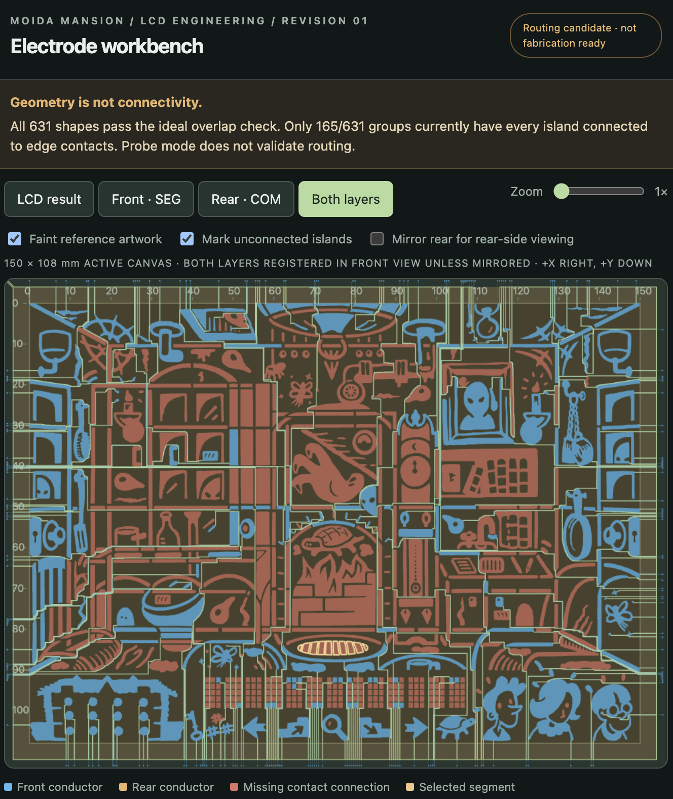
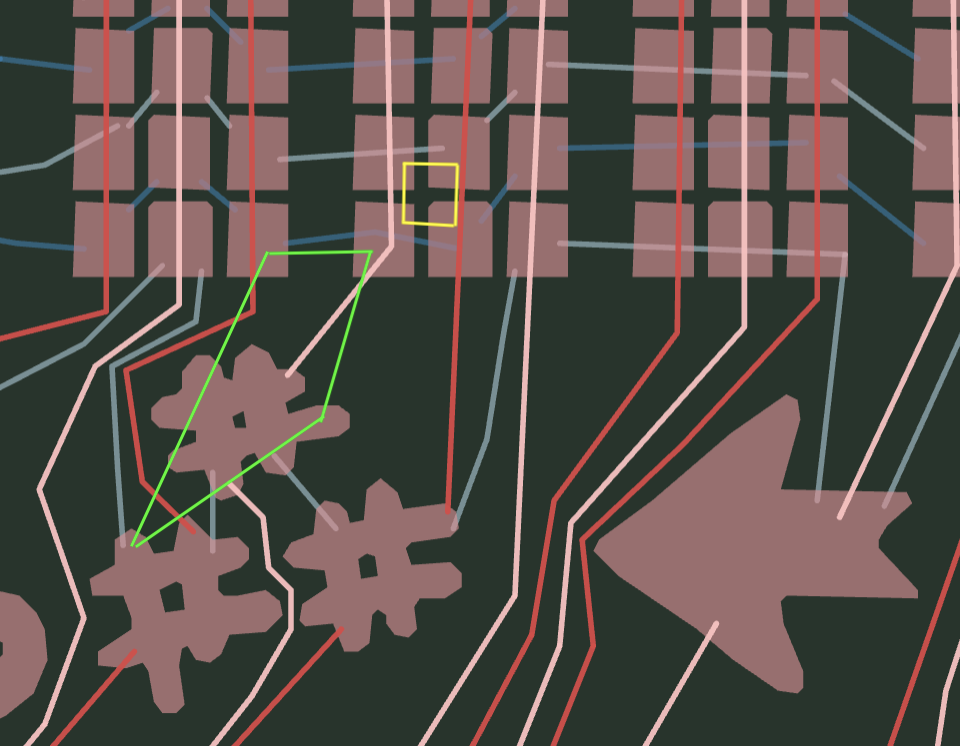
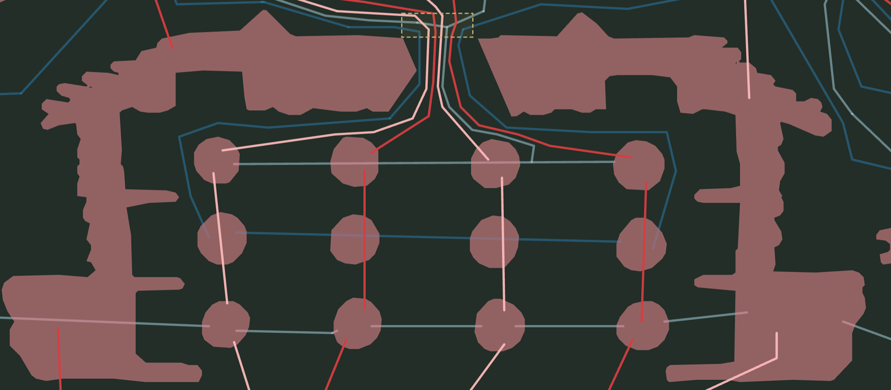

# Moida Mansion AI recreate in physical form

## Introduction

[Moida Mansion](https://dukope.itch.io/moida-mansion) is a 2024 video game by independent developer Lucas Pope. It is a browser game that imitates the visual design and gameplay of a handheld electronic game.

When I first see this game, I was thinking if it is possible to port it to a physical console with a customized LCD. However, extracing resources and doing LCD layout can be quite complicated. So I did not really do anything, until I had an OK experience with OpenAI GPT-6 Astra on PCB design. An here is logging of my progress.

## Extract resources

Extracing resources LCD resource with AI is very straight forward. Just ask Astra to figure out the segments and connections, I got this in 7 minutes:

## Evaluate difficulty

There are 631 segments, that is way more segments than those Game & Watch or Tiger Electronics LCD consoles in 80s. I've checked the 4-bit Microcontroller the Game & Watch used, Sharp SM512. That Microcontroller supports 4 common lines and up to 50 segments. Overall the theoretical maximum segments are 50*4=200. So this LCD was not possible at that age.

The biggest LCD driver I can found is Holtek [HT16C24A](https://www.holtek.com/page/vg/HT16C24A) or [HT1626](https://www.holtek.com/page/vg/HT1626). They have up to 16 commons and 60 segments. That is 16*16=960 segments. So it is possible to drive a Moida Mansion LCD.

On the LCD side, I found a vendor that can customize LCD for samples. The specs are: 

Min track width and spacing: 0.12mm

Min segments spacing: 0.1mm

And the bigger the more expensive. 

Let's take the challenge.

## How LCD works in design perspective

Here I skip the physics about LCD, just talk about design.

Rows and column are layed on top and bottom of LCD screen. The overlapped area can be turned on. It seems like a 2 layer PCB without vias. The rows and column should form a matrix to maximize segments but they do not need to be on grid, they can be distorted to fit the segments.

## Routing the LCD

Will the Astra do the job for me?

The failure is expected. So let's go one step back and just make a tool to manually route the traces with DRC.

And after about 30 hours of routing, it is proven to be possible with 16x48 matrix!

Some tricks in routing. Since the topology of LCD matrix is a grid, we need to assign the segment in a grid way to avoid trace crossing. The grid in matrix area might be simple and easy to understand (yellow), but the grid can also be distorted to fit the segments (green). Also, the traces are colored with lighter and darker color alternatively, making reading easier.

Also to make the routing possible, I need to change some of the segment. For example, the house map ceiling is blocking me from routing traces up, so I have to make an opening in the ceiling. Also I made the traces cross there to save COM lines. It will cause some black dots in some cases, but that location should be fine.

And for some segments, I sliced them to be more sub segment to allow multiple wires to travel through them.

# Refine routing for manufacture

